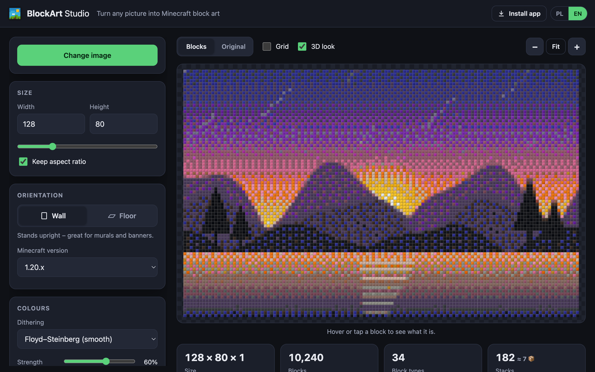
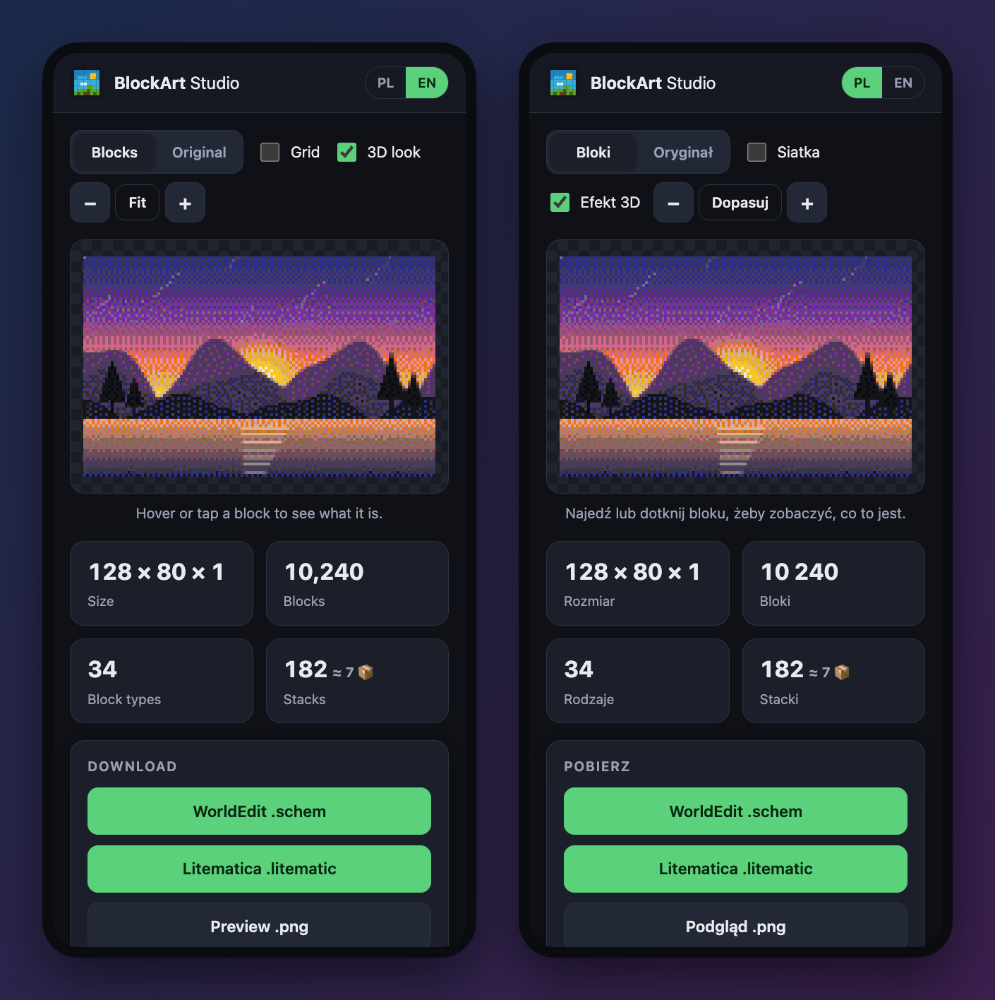

<div align="center">


# BlockArt Studio

**Turn any picture into Minecraft block pixel art and paste it straight into your world.**

[**▶ Open the app**](https://patryk-niedzielski.github.io/blockart-studio/) · Works on desktop, tablet & phone · Installable · Works offline



</div>

## Features

- 🖼️ **Any image**: drag & drop, paste (Ctrl/⌘+V), pick a file, or take a photo on your phone.
- 🎨 **Accurate colours**: matching happens in the perceptual **OKLab** colour space, with Floyd–Steinberg, Atkinson or ordered dithering, plus brightness, contrast and saturation controls.
- 🧱 **150+ blocks in 10 groups**: concrete, wool, terracotta, concrete powder, planks, stone, natural, Nether, ores & metals, light sources. Toggle whole groups or single blocks.
- 🧭 **Version aware**: from 1.13 to 1.21. Blocks that don't exist in your version are left out automatically.
- 🧩 **Wall or floor**: upright murals or flat floor and map art, up to 512 × 512 blocks.
- 🔍 **Inspect**: zoom (buttons, Ctrl+scroll, pinch), a block grid with 16-block chunk lines, and hover or tap any block to see its name and coordinates.
- 📦 **Exports**
  - **WorldEdit `.schem`** (Sponge v2: WorldEdit 7+, FAWE, Axiom, Amulet)
  - **Litematica `.litematic`**: build it in survival with a hologram
  - **Material list** in blocks, stacks and shulker boxes (`.txt` or clipboard)
  - **PNG preview**
- 📱 **PWA**: install it on your phone or desktop. It works offline after the first visit.
- 🔒 **Private**: everything runs in your browser and your images are never uploaded.
- 🌍 English & Polish.



## Using it in Minecraft

### WorldEdit / FAWE
1. Copy the `.schem` file to `.minecraft/config/worldedit/schematics/` (on a server: `plugins/WorldEdit/schematics/`).
2. `//schem load <name>`
3. **Wall**: stand where you want to view it from, **face north** and run `//paste`. It appears 3 blocks in front of you, centred.
   **Floor**: stand in the middle of the target area and run `//paste`. It replaces the layer under your feet.
4. Facing the wrong way? Run `//rotate 90` before pasting, or `//undo`.

### Litematica (survival)
1. Copy the `.litematic` file to `.minecraft/schematics/`.
2. Press **M**, then **Load Schematics**, pick the file and click **Load**.
3. Move the placement and build along the hologram. Litematica's material list works too.

## Development

No build step and no dependencies: plain ES modules.

```bash
python3 tests/serve.py 8765        # or any static file server
open http://localhost:8765
```

| File | Purpose |
| --- | --- |
| `js/blocks.js` | Block palette (colours, categories, versions) |
| `js/color.js` | OKLab matching, adjustments, dithering |
| `js/nbt.js` | NBT writer, varints, gzip (with fallback) |
| `js/export.js` | `.schem` / `.litematic` / material list builders |
| `js/app.js` | UI |
| `sw.js` | Offline cache (bump `CACHE` on release) |

### Tests

```bash
python3 tests/serve.py 8765 /tmp/e2e.html &
# unit tests + file-format fixtures, checked by an independent Python NBT reader
"/Applications/Google Chrome.app/Contents/MacOS/Google Chrome" --headless=new --virtual-time-budget=5000 \
  --dump-dom http://localhost:8765/tests/run.html > /tmp/run.html && python3 tests/verify.py /tmp/run.html
# end-to-end: clicks through the UI and verifies the downloaded files
#   open http://localhost:8765/tests/e2e.html in Chrome; the result is POSTed to /tmp/e2e.html
python3 tests/verify_e2e.py /tmp/e2e.html
```

## 🇵🇱 Po polsku

**BlockArt Studio** zamienia dowolny obrazek w pixel art z bloków Minecrafta. Ustawiasz rozmiar, ułożenie (ściana albo podłoga), wersję gry i paletę bloków. Potem pobierasz plik `.schem` do WorldEdita albo `.litematic` do Litematiki, razem z listą materiałów. Aplikacja działa na komputerze i telefonie, można ją zainstalować i działa bez internetu.

[**▶ Otwórz aplikację**](https://patryk-niedzielski.github.io/blockart-studio/)

---

MIT License. Not an official Minecraft product. Not approved by or associated with Mojang or Microsoft. Block colours are averaged approximations, and no game textures are included.
